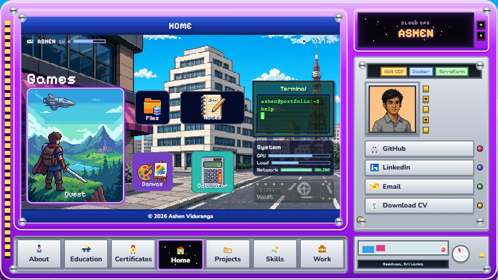
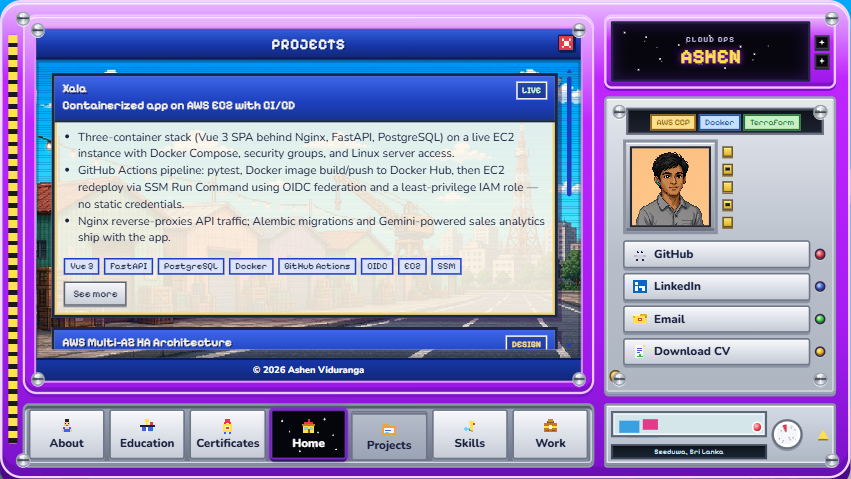
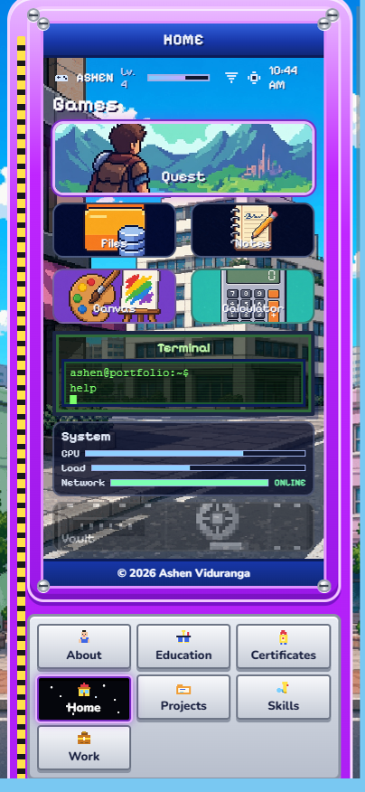
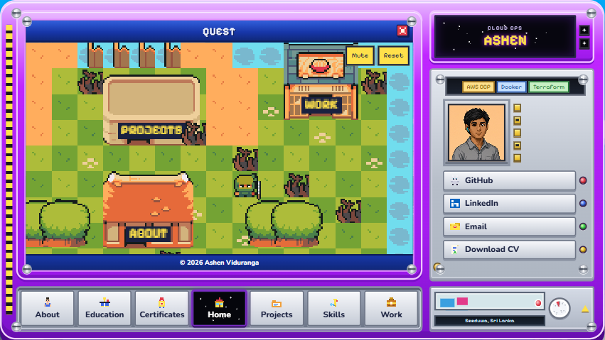

# Ashen Viduranga — Pixel Console Portfolio

A one-page DevOps portfolio drawn as a handheld pixel console. Education, certificates, projects, skills, and work all come from one JSON file, so the copy can change without touching the UI. The live site is [hosted on AWS Amplify](https://main.d1u871v01h15e8.amplifyapp.com/).

Built with React 19, TypeScript, and Vite 7. `npm run build` writes a static `dist/` folder. Asset URLs are relative (`base: "./"` in [vite.config.ts](vite.config.ts)), so the same build works on a project path or a custom domain.

## Screenshots

### Console



From 960px wide the page is a handheld console: home screen, module keys, and a side panel with the portrait, badges, and contact links. Between 960px and 1100px the console fits the window with no scale. From 1101px it uses the full desktop console. That covers full laptop windows, a browser snapped to half of a 24-inch display, and iPads in landscape.

### Projects



The module keys open About, Education, Certificates, Projects, Skills, and Work. A project with an article has a longer markdown page.

### Phone



Below 960px the modules stack into the phone layout when `default mobile view` is true in [public/content.json](public/content.json). A **Phone layout / Console layout** button can flip that for the rest of the visit; it is not saved, so a refresh returns to the band default. The button stays hidden from 1101px unless that visit override is on. Snap a 14-inch laptop to half the window (~640–768px) and you get the phone stack. Rotate a phone or iPad to landscape (960px+) and it uses the fitted console.

### Quest



Quest is a small field. Tap the ground to walk, pick a kit, and tap a marked place to read that section of the portfolio.

## On the console

**Home.** Quest, Files, Notes, Canvas, and Calculator sit on the city wallpaper, with a terminal prompt and a system readout. Notes stay in this browser under `console-notes`. Files holds section pictures and launchers for the installed apps. `system_files` stays locked.

**Terminal.** Open it from the home screen. It reads the same `content.json` as the modules.

| Command | What it prints or opens |
| --- | --- |
| `help` | The command list |
| `whoami`, `about` | Name, role, location, badges |
| `education`, `certs`, `skills`, `work` | Those sections |
| `projects`, `ls` | Project ids and titles |
| `cat <id>` | One project |
| `open <id>` | That project's article, when it has one |
| `contact` | GitHub, LinkedIn, email, and the CV path |
| `files`, `notes`, `canvas`, `calculator`, `quest` | That app, if it is installed and enabled |
| `ps` | Enabled services |
| `apt list` | Extra packages |
| `apt install\|uninstall <app>` | Install or remove an app |
| `systemctl enable\|disable <app>` | Turn an installed app on or off |
| `clear` | Clear the screen |

Vault starts uninstalled, and the console has no free slot for it. Free one, then turn Vault on:

```text
apt uninstall notes
apt install vault
systemctl enable vault
```

**Projects.** Cards come from the `quests` array. An `article` field, such as `"xala.md"`, loads that file from [public/articles/](public/articles/) when you choose **See more** or open `#article/xala`. The hash uses the quest id.

## Run it locally

```bash
npm install
npm run dev
```

Open the localhost URL Vite prints. Production build:

```bash
npm run build
npm run preview
```

`npm run build` typechecks with `tsc --noEmit`, then writes `dist/`. Saving [public/content.json](public/content.json) full-reloads the dev server.

## Change the copy

Edit [public/content.json](public/content.json) and refresh. That file is the profile, badges, education, certificates, skills, projects, work, and the save-data lines on the About record in Quest.

A badge is `{ "label": "AWS CCP", "tone": "gold" }`. Tones are `gold`, `cyan`, and `mint`.

A certificate is one object:

```json
{ "title": "New cert", "issuer": "Amazon Web Services", "when": "Oct 2026" }
```

Project bullets are an array of strings. Set `article` to a markdown file name in `public/articles/` when the project has a long write-up. Leave it off when the card is enough.

The CV download uses `profile.cvFile`. Replace [public/Ashen_Viduranga_DevOps_Intern.pdf](public/Ashen_Viduranga_DevOps_Intern.pdf), or point `cvFile` at another file in `public/`.

Commit the JSON (and any new article or PDF) so the host rebuilds. On S3, upload the new files from `dist/` after `npm run build`.

## Where things live

- [src/App.tsx](src/App.tsx) — which module, tool, or `#article/…` page is open
- [src/components/console/](src/components/console/) — the console, home apps, terminal, and Quest
- [src/data/content.ts](src/data/content.ts) — the shape of `content.json`
- [public/content.json](public/content.json) — the words on the site
- [public/articles/](public/articles/) — project write-ups
- [public/console/](public/console/) — scenes, portrait, and Quest art
- [docs/screenshots/](docs/screenshots/) — the pictures in this README (they are not part of `dist/`)
